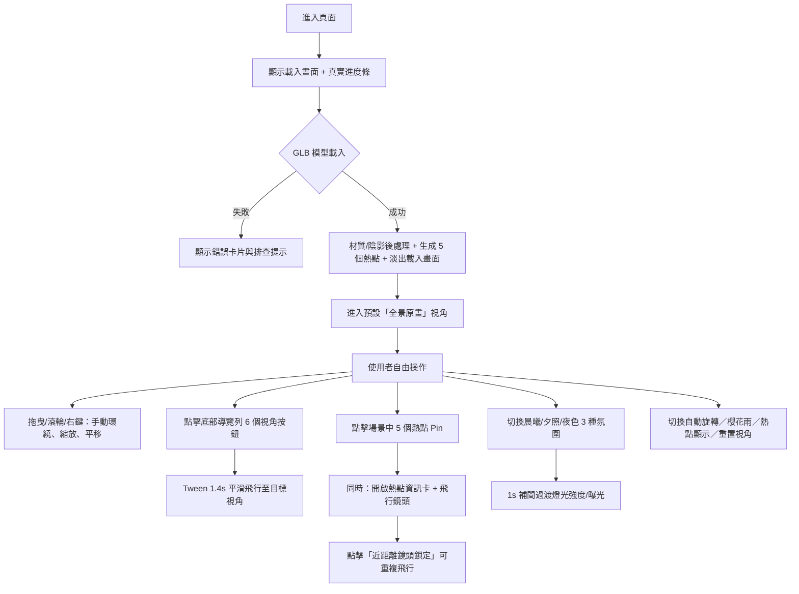

# 長門櫻的房間 · 3D 沉浸式互動導覽網頁
## 產品需求文件（PRD）v1.0

| 項目 | 內容 |
|---|---|
| 文件版本 | v1.0（現況盤點 + 迭代路線圖） |
| 撰寫日期 | 2026-09-18 |
| 產品型態 | 純前端靜態網頁（No Backend / No Build Tool） |
| 文件狀態 | 草案 — 以現有原型程式碼為基礎逆向盤點後撰寫 |
| 對應檔案 | `index.html`、`styles.css`、`app.js`、`RoomEnvironment.js`、`nagato_sakura_room.glb` |

> **本文件的特殊性**：這不是一份從零開始的「畫大餅」PRD，而是先完整審查現有五個檔案（含直接解析 GLB 二進位結構）之後，把**已經做出來的東西**系統化地寫成正式規格，再從中找出落差、風險與下一步優化方向。文件後半段（第 8 章起）是給後續迭代使用的路線圖。

---

## 目錄
1. 專案概述與產品願景
2. 目標受眾與使用情境
3. 產品範疇（Scope）
4. 現況功能盤點（依程式碼逐項列出）
5. 資訊架構與使用者流程
6. 視覺設計系統
7. 技術架構
8. 現況缺口與風險分析
9. 產品路線圖（Roadmap）
10. 效能預算與優化計畫
11. 無障礙與國際化
12. 音效系統規劃（目前為未完成功能）
13. QA / 測試計畫
14. 部署與維運
15. 驗收標準與成功指標
16. 時程規劃
17. 附錄

---

## 1. 專案概述與產品願景

### 1.1 產品名稱
**長門櫻的房間 · 3D 沉浸式互動導覽**（英文：*Nagato Sakura's Room — 3D Immersive Interactive Tour*）

### 1.2 一句話定位
一個不需安裝、不需帳號、純瀏覽器即可執行的 **3D 角色房間鑑賞網站**，讓使用者能像逛展覽一樣，用滑鼠或手指自由環繞、縮放、平移，近距離欣賞一個以日系動漫角色「長門櫻」為主題、高細節手工建模的臥室場景，並透過熱點標記閱讀每件家具道具背後的設計小故事。

### 1.3 產品願景
把「角色設定集裡的一張房間插畫」，變成「可以走進去逛的空間」。核心體驗價值在於**細節的可發現性**（discoverability）——地毯、吊飾、被褥、書架上的每一件小物都有自己的敘事，使用者透過探索行為主動獲得內容，而不是被動看一張圖或一段影片。

### 1.4 專案背景
目前專案已完成一版可運作的原型（單一靜態頁面，直接開啟 `index.html` 即可執行，唯讀取 `.glb` 模型需在本機伺服器環境下，因瀏覽器對 `file://` 協定的 CORS/fetch 限制）。本 PRD 的目的是：
1. 把目前隱含在程式碼裡的規則（鏡頭座標、燈光參數、熱點內容）轉成可維護、可交接的正式規格；
2. 盤點 3D 模型裡「已建模但尚未被網頁邏輯使用」的部分，找出低成本、高回報的下一步擴充項；
3. 為後續效能優化、無障礙、音效等待補項目建立可執行的路線圖。

### 1.5 名詞定義

| 名詞 | 說明 |
|---|---|
| Hotspot（熱點） | 場景中可點擊的圓形 📍 標記，點擊後開啟資訊卡並飛行鏡頭至該處 |
| Camera Preset（視角預設） | 一組固定的鏡頭位置 + 注視目標 + FOV，透過底部導覽列一鍵到達 |
| Atmosphere（時段氛圍） | 燈光/色溫/曝光的整組參數集合，對應晨曦、夕照、夜色三種模式 |
| PMREM 環境貼圖 | 用 `RoomEnvironment.js` 產生的預濾波環境反射貼圖，僅套用在金屬材質上，不套用在整個場景 |
| glTF / GLB | 3D 模型交換格式，`.glb` 為其二進位打包版本，本專案的房間模型即為此格式 |

---

## 2. 目標受眾與使用情境

### 2.1 目標受眾

| 受眾 | 需求 |
|---|---|
| 角色/IP 愛好者 | 想「住進」喜歡的角色房間，重視氛圍與細節彩蛋 |
| 3D 建模／技術美術作品集訪客 | 想看建模品質、材質處理、燈光調校手法 |
| Three.js / WebGL 學習者 | 想參考純前端（無框架、無打包工具）如何做出這種體驗 |
| 一般社群分享觀眾（行動裝置為主） | 透過連結點進來隨手滑一滑、看幾個熱點就離開 |

### 2.2 核心使用情境
- 使用者從社群貼文/連結進入頁面 → 等待載入 → 用手指滑動探索房間 → 點擊發光的熱點看介紹 → 切換晨昏夜三種氛圍拍「美照」截圖分享。
- 建模/開發同好想觀摩實作，直接查看原始碼與模型結構。

### 2.3 成功的使用者體驗長什麼樣
- 載入等待感受得到「值得等」（有進度、有品牌感，不是空白卡住）。
- 第一眼視角（全景原畫）就要讓人有「哇，好可愛」的第一印象。
- 熱點好發現、好理解，點擊後的資訊有溫度、非制式規格文字。
- 三種氛圍切換要有明顯情緒差異（不是只是調亮度）。

---

## 3. 產品範疇（Scope）

### 3.1 In-Scope（現況與本文件規劃範圍）
- 100% 純前端靜態網頁：HTML + CSS + Vanilla JS，無框架、無建置流程、無後端 API。
- 單一 3D 場景（一個房間），透過 Three.js 渲染，OrbitControls 自由環繞。
- 六組固定鏡頭視角、三種時段氛圍、五個內容熱點。
- 櫻花飄落視覺特效（2D Canvas 粒子）。
- 響應式版面（桌面／行動裝置）。

### 3.2 Out-of-Scope（明確不做）
- 使用者帳號、留言、收藏、社群互動。
- 電商／贊助／課金機制。
- 多人共同瀏覽（Multiplayer）。
- CMS 後台或動態內容管理（所有內容目前是寫死在 `app.js` 的 JS 物件中）。
- 原生 App（僅限 Web）。

> 以上「不做」是依現有架構（純靜態、無後端）自然推導出的範疇邊界，若未來要做熱點內容的後台編輯，將是架構層級的重大變更，建議另開專案評估。

---

## 4. 現況功能盤點（依程式碼逐項列出）

### 4.1 載入流程
- 進場即顯示全螢幕 Loading Screen：旋轉櫻花花瓣動畫（5 瓣, CSS `rotateBlossom` 8 秒一圈）、標題、進度條、百分比文字。
- 進度條綁定 `GLTFLoader` 的 `onProgress`（`xhr.loaded / xhr.total`），為**真實載入進度**而非假動畫。
- 模型載入失敗時，Loading Screen 會替換為錯誤訊息卡片（提示需在本機伺服器環境開啟），而非白屏或無限轉圈。
- 模型載入成功後，延遲 400ms 再淡出 Loading Screen（`fade-out` class，0.8s 過渡），讓最後一點材質處理有時間完成，體感更順。

### 4.2 3D 場景資產：`nagato_sakura_room.glb`

| 屬性 | 數值 |
|---|---|
| 檔案大小 | 約 7.76 MB（8,137,892 bytes） |
| glTF 版本 | 2.0（二進位 `.glb`） |
| 產出工具 | Blender glTF I/O v5.2.40（即以 Blender 建模、匯出） |
| 場景數 Scenes | 1 |
| 節點數 Nodes | 484 |
| 網格數 Meshes | 472 |
| 材質數 Materials | 47 |
| 貼圖/圖片 Textures/Images | 5 |
| 動畫 Animations | **0**（模型不含任何骨架/關鍵影格動畫） |
| Accessors | 1,444 |

**關鍵技術含意**：動畫數為 0，代表模型本身是「靜態擺設」，任何未來想做的開闔動作（衣櫃開門、抽屜拉出、窗簾拉動）都**無法**靠播放內建動畫達成，必須在 Three.js 端手動對特定節點做旋轉/位移補間（Tween），且模型中已經預留了一批 `Target_*` 空物件（見 4.2.1），這些很可能就是建模時特意留下、給互動邏輯掛鉤旋轉軸心用的支點。

#### 4.2.1 場景節點分組統計（依命名前綴歸納）

| 分組前綴 | 子節點數 | 推測內容 |
|---|---|---|
| `SM_Bedside` | 70 | 床頭櫃（目前模型中**細節密度最高**的區域，但完全沒有對應熱點/視角） |
| `ENV_Plant` | 65 | 常春藤盆栽（枝幹/花冠/藤蔓/葉片分層建模） |
| `SM_Book` | 56 | 書架上的書籍 |
| `SM_Curtain` | 29 | 窗簾（含 `Target_Curtain` 支點） |
| `SM_AC` | 28 | 冷氣機（含白色機身、金屬蓋、LED 燈號綠/冷/橘三色專屬材質） |
| `SM_Chair` | 25 | 書桌椅 |
| `SM_Bookshelf` | 25 | 書架主體 |
| `SM_Window` | 24 | 窗戶（含 `Target_Window` 支點） |
| `SM_Desk` | 22 | 書桌主體 |
| `PROP_Photo` | 14 | 相框（**多達 14 個子件，推測為牆面多張照片牆**，目前完全未被提及） |
| `PROP_Sakura` | 14 | 櫻花吊飾（5 瓣花瓣＋花蕊＋隔珠＋流蘇，與現有熱點描述完全吻合） |
| `SM_Sketchpad` | 14 | 手帳本/素描本 |
| `PROP_Main` | 10 | 長門櫻白貓玩偶（身體/耳朵/內耳/眼睛/腮紅/口鼻，共約 9–10 件） |
| `SM_Storage` | 8 | 收納箱（含 `Target_Storage` 支點；對應粉彩色系收納盒材質） |
| `SM_Bookend` | 8 | 書擋 |
| `SM_Pen` | 7 | 筆具 |
| `SM_Wall` | 7 | 牆面分件 |
| `SM_Wardrobe` | 5 | 衣櫃（含 `Target_Wardrobe` 支點） |
| `SM_Notebook` | 5 | 筆記本 |
| `SM_Laptop` | 6 | 筆電（含螢幕獨立材質 `MAT_Laptop_Screen`） |
| `PROP_Scroll` | 3 | 櫻花捲軸畫 |
| `PROP_Badge` | 3 | 徽章/吊飾配件 |
| `SM_Baseboard` | 2 | 踢腳板 |
| `SM_Pillow` | 2 | 抱枕 |
| `SM_Slippers` | 2 | 拖鞋（含 `Target_Slippers` 支點） |
| `PROP_Poster` | 2 | 角色立繪海報 |
| `SM_Bed` | 8 | 床鋪主體 |
| `PROP_Light` | 1 | 電燈開關 |
| `SM_Door`／`SM_Floor`／`SM_Corner`／`SM_Diorama`／`SM_Star`／`SM_Trinket`／`SM_Pastel`／`SM_Pencil` | 各 1 | 房門、地板、牆角、小型立體模型座、星形抱枕、擺飾小物、粉彩元件、鉛筆 |
| `Target_*`（AC/Bed/Bedside/Bookshelf×2/Curtain/Desk/Slippers/Storage/Wardrobe/Window） | 共 11 | 疑似互動支點空物件，**目前 JS 完全沒有讀取或使用這些節點** |

### 4.3 攝影機系統與六大導覽視角

鏡頭切換由 `flyToCamera()` 驅動，使用 `TWEEN.js` 對 `camera.position`、`controls.target`、`camera.fov` 三者同時做 1400ms 的 Cubic InOut 補間，並在補間期間鎖定 `controls.enabled = false` 避免手動操作與自動飛行互相干擾。

| 視角 ID | 名稱 | 鏡頭位置 (x, y, z) | 注視目標 (x, y, z) | FOV | 觸發入口 |
|---|---|---|---|---|---|
| `iso` | 全景原畫 | (-8.8, 6.2, 8.8) | (-2.2, 1.0, 2.2) | 42° | 底部導覽列（預設視角）＋「地毯」熱點 |
| `charm` | 櫻花吊飾 | (-1.30, 0.95, 3.35) | (-0.655, 0.88, 3.61) | 38° | 底部導覽列＋熱點 |
| `bed` | 櫻花大床 | (-2.6, 1.65, 2.3) | (-0.85, 0.65, 0.90) | 40° | 底部導覽列＋熱點 |
| `desk` | 書桌工作區 | (-2.35, 1.55, 1.9) | (-3.00, 0.95, 0.35) | 40° | 底部導覽列＋熱點 |
| `bookshelf` | 書架收藏 | (-1.95, 1.45, 2.5) | (-0.30, 1.15, 2.55) | 40° | 底部導覽列＋熱點 |
| `window` | 窗台晨景 | (-1.20, 1.65, 2.2) | (-1.20, 1.62, -0.05) | 42° | **僅底部導覽列**（無對應熱點，見第 8 章缺口分析） |

環繞控制（`OrbitControls`）限制：`minDistance=1.0`、`maxDistance=22.0`、`maxPolarAngle = 90° - ~0.57°`（防止鏡頭鑽到地板以下）、`enableDamping=true`（阻尼 0.06，賦予慣性滑順感）。

### 4.4 時段氛圍燈光系統

三種模式共用同一組燈具實體（環境光、半球光、主光源太陽光、室內補光、桌燈），切換時透過 `TWEEN` 對每個燈的 `intensity` 做 1000ms 補間，顏色/位置則為瞬間切換。

| 參數 | 晨曦 Morning（預設） | 夕照 Sunset | 夜色 Night |
|---|---|---|---|
| 場景背景色 | `#f2eef4` 淺灰紫 | `#f5e2da` 暖杏 | `#181726` 深藍夜 |
| 環境光 AmbientLight | `#fff2ea` · 0.35 | `#ffd8c4` · 0.32 | `#4d5578` · 0.20 |
| 半球光 天空/地面 · 強度 | `#fff6ee` / `#dfd3c5` · 0.22 | `#ffc4a8` / `#b8806a` · 0.22 | `#333b5c` / `#1e2030` · 0.15 |
| 太陽光 DirectionalLight 顏色·強度 | `#fff5e6` · 1.15 | `#ff7d4d` · 1.40 | `#768ec5` · 0.30 |
| 太陽光位置 | (-1.5, 5.0, -4.5) | (-2.6, 3.4, -5.2) | (-1.2, 4.2, -3.8) |
| 室內補光 PointLight | `#ffecd2` · 0.35 | `#ffb085` · 0.45 | `#ffd39b` · 0.70 |
| 桌燈 Desk Lamp 強度 | 0（關） | 0.6（微亮） | 2.0（主要光源） |
| 渲染曝光 toneMappingExposure | 0.88 | 0.86 | 0.84 |

太陽光具備 2048×2048 陰影貼圖（`PCFSoftShadowMap` 柔和陰影），正交陰影相機範圍 ±5，`shadow.bias=-0.0004` 防止陰影自遮蔽瑕疵。玻璃、天空背板、紗簾材質被排除於陰影投射之外。

### 4.5 互動熱點系統

熱點是 DOM 元素（非 3D 物件），每幀透過 `Vector3.project(camera)` 把世界座標投影成螢幕座標並更新 `left/top`；當投影後 `z ≥ 1.0`（在鏡頭後方）時隱藏該熱點。

| Hotspot ID | 標題 | 分類 Badge | 內容摘要 | 對應視角 | 與 GLB 節點對照 |
|---|---|---|---|---|---|
| `hotspot-charm` | 和風五瓣櫻花吊飾 | 匠心細節 | 5 瓣立體花瓣、金色花蕊、金屬隔珠、18 條絲線流蘇 | `charm` | 對應 `PROP_Sakura`（14 子件） |
| `hotspot-bed` | 櫻花花瓣雙人被褥 | 舒適臥眠 | 粉色櫻花＋水彩藍漸層被褥、枕頭、星形抱枕、白貓玩偶 | `bed` | 對應 `SM_Bed`, `SM_Pillow`, `PROP_Main` |
| `hotspot-desk` | 創作用書桌與筆電 | 靈感空間 | 淺橡木書桌、筆電、檯燈、手帳本、角色立繪海報、櫻花捲軸畫 | `desk` | 對應 `SM_Desk`, `SM_Laptop`, `PROP_Poster` |
| `hotspot-bookshelf` | 收藏書架與常春藤盆栽 | 少女日常 | 五層書架、輕小說、設定集、相框、分類文件盒、常春藤盆栽 | `bookshelf` | 對應 `SM_Bookshelf`, `SM_Book`, `ENV_Plant` |
| `hotspot-rug` | 手繪櫻花水彩地毯 | 和風軟裝 | 短絨印花地毯，鋪於日系淺橡木地板 | `iso` | 對應地板區域材質 `MAT_Rug_Sakura` |

### 4.6 UI 總覽

| 區塊 | 內容 |
|---|---|
| 頁首 Header | 品牌徽章（🌸 櫻花和風部屋）、中英雙語主標題、BGM 按鈕、指南（❓ Help）按鈕 |
| 底部導覽 Dock | 三分區＋兩條分隔線：①「導覽視角」6 顆 Pill 按鈕 ②「時段氛圍」3 顆 Pill 按鈕 ③「特效輔助」4 顆按鈕（自動旋轉／櫻花雨開關／熱點標記開關／重置視角） |
| 熱點資訊卡 Modal | 分類徽章＋標題＋說明＋「近距離鏡頭鎖定」CTA |
| 操作指南 Modal | 條列滑鼠/觸控操作方式（拖曳旋轉、滾輪縮放、右鍵平移、點擊熱點、底部導覽列） |
| Loading Screen | 旋轉花瓣 Logo、標題、進度條、百分比 |

### 4.7 櫻花飄落特效（2D Canvas 粒子系統）
獨立於 3D 場景之上疊加一層 `<canvas id="sakura-canvas">`，共 36 片花瓣，以貝茲曲線繪製心形花瓣輪廓，具備獨立下墜、正弦擺動、旋轉、翻轉厚度變化及透明度。

### 4.8 響應式設計
於 `max-width: 768px` 斷點自動調整，隱藏副標題與部分輔助標籤，底部導覽 Dock 支援橫向平滑捲動。

### 4.9 材質與光影處理邏輯
- 移除模型內建光源避免重複暴光。
- 金屬嚴格依名稱匹配（`matName.includes('metal')`）賦予 `metalness=0.85`、`roughness=0.22` 並套用 PMREM 反射貼圖，非金屬材料 `metalness=0` 且不設置環境反射，避免泛白過曝。
- 布料、絨毛強制設為全消光 `roughness=0.95`，確保布料溫潤質感。

---

## 5. 資訊架構與使用者流程

---

## 6. 視覺設計系統

### 6.1 色彩 Token（取自 `:root` CSS 變數）

| Token | 色碼 | 用途 |
|---|---|---|
| `--primary-pink` | `#ff758f` | 主色，按鈕漸層起點、強調色 |
| `--sakura-blush` | `#ffb3c1` | 花瓣漸層、次強調 |
| `--sakura-pale` | `#fff0f3` | 徽章底色、Badge 背景 |
| `--accent-gold` | `#ffb703` | 保留之強調色 |
| `--accent-blue` | `#70d6ff` | 保留之強調色 |
| `--text-primary` | `#2b2d42` | 主要文字 |
| `--text-secondary` | `#5c677d` | 次要文字/說明文字 |
| `--bg-glass` / `--bg-glass-hover` | `rgba(255,255,255,.72)` / `.88` | 玻璃擬態面板底色 |
| `--bg-dark-glass` | `rgba(26,26,46,.75)` | 深色玻璃底 |

### 6.2 圓角與陰影
- `--radius-pill: 9999px`：所有按鈕、徽章膠囊形。
- `--radius-card: 20px`：Modal 卡片圓角。
- `--shadow-soft` / `--shadow-dock`：柔和粉色調陰影。

### 6.3 字體
- `Outfit`：英文/數字
- `Noto Sans TC`：中文內文
- `Zen Maru Gothic`：日系圓體

---

## 7. 技術架構

| 分類 | 選用技術 | 版本/來源 |
|---|---|---|
| 3D 渲染引擎 | Three.js | r128（`cdnjs.cloudflare.com`） |
| 鏡頭控制 | OrbitControls | 對應 three@0.128.0（`cdn.jsdelivr.net`） |
| 模型載入 | GLTFLoader | 對應 three@0.128.0（`cdn.jsdelivr.net`） |
| 補間動畫 | Tween.js | 18.6.4（`cdnjs.cloudflare.com`） |
| 環境反射 | 自製 `RoomEnvironment.js` | 改寫自 Google model-viewer |
| 字體 | Google Fonts | Noto Sans TC / Outfit / Zen Maru Gothic |
| 後端 | 無 | 純靜態檔案 |

---

## 8. 現況缺口與風險分析

| # | 項目 | 現況描述 | 影響 | 建議優先級 |
|---|---|---|---|---|
| 1 | BGM 按鈕為視覺假按鈕 | `isAudioPlaying` 只切換按鈕文字與樣式，未實際播放音訊 | 使用者預期有聲音卻無反應 | **P0** |
| 2 | 熱點無遮擋（Occlusion）判斷 | 僅檢查 `z < 1.0`，未做射線相交測試 | 視角翻轉時熱點可能穿牆可見 | P1 |
| 3 | 「窗台晨景」視角缺少對應熱點 | 底部導覽列有 6 個按鈕，但場景內只有 5 個熱點，缺少窗台熱點 | 互動模式不完全一致 | P1 |
| 4 | 大量已建模但未被使用的區域 | `SM_Bedside`（70 子件）、`PROP_Photo`（14 相框）、`SM_AC`（28 子件）等尚未設置熱點 | 內容擴充最大潛在價值點 | P1 |
| 5 | 場景背景色於氛圍切換時「瞬切」 | `scene.background` 未納入 TWEEN 漸變 | 切換氛圍時背景會跳變 | P2 |
| 6 | 無 WebGL 支援性檢查 | 缺少友善降級提示 | 舊裝置可能白屏無提示 | P1 |
| 7 | 多來源 CDN 版本耦合風險 | cdnjs 與 jsdelivr 混合引用 | 若升級時版本不一致可能拋錯 | P1 |
| 8 | `Zen Maru Gothic` 未套用 | 已引用但 CSS 未套用在標題/標籤 | 可進一步優化字體視覺質感 | P2 |
| 9 | 相對路徑載入 GLB 無版本快取策略 | `modelUrl = 'nagato_sakura_room.glb'` | 模型更新後快取問題 | P2 |
| 10 | 無 Draco 幾何壓縮 | 7.76MB 單次下載 | 行動網路首次下載較久 | P1 |

---

## 9. 產品路線圖（Roadmap）

### Phase 0（現況基準）
已完成：3D 場景、六視角、三氛圍、五熱點、櫻花特效、玻璃擬態 UI、響應式版面、載入進度條。

### Phase 1 — 修正與一致性補齊（P0 / P1）
- 實作真實 BGM 播放（支援 Web Audio 白噪音/治癒和弦音效，免依賴外部大檔音訊）。
- 補齊「窗台」熱點 Pin（`hotspot-window`）。
- 實作背景色平滑 TWEEN 補間過渡。
- 熱點加入射線遮擋判斷（Raycaster Occlusion）。
- WebGL 支援性檢查與友善提示。
- 套用 `Zen Maru Gothic` 提升日系溫馨氛圍。

### Phase 2 — 內容擴充
- 新增熱點：床頭櫃手帳與時鐘、回憶相框牆、冷氣機、電燈開關彩蛋。
- 探索式支點互動（衣櫃開門、窗簾拉動補間）。

### Phase 3 — 效能優化
- Draco / Meshopt 壓縮、貼圖 WebP/KTX2 轉換。

### Phase 4 — 無障礙與國際化
- 鍵盤操作、`prefers-reduced-motion` 偏好支援、繁中/英文雙語切換。

### Phase 5 — 驚喜加分項
- WebXR VR 模式、社群打卡截圖分享生成器、即時日夜自動同步。

---

## 10. 附錄：47 個材質完整清單

`MAT_Plant_Leaf`、`MAT_Ceramic_White`、`MAT_Wood_Oak`、`MAT_Tree_Bark`、`MAT_Fabric_Blue`、`MAT_Fabric_Pink`、`MAT_Fabric_White`、`MAT_Plush_Pink`、`MAT_Plush_Blue`、`MAT_Plush_Eyes`、`MAT_Plush_White`、`MAT_Wood_Dark`、`MAT_Poster_Art`、`MAT_Paper`、`MAT_Metal_Gold`、`MAT_Scroll_Art`、`MAT_AC_White`、`MAT_Metal_Silver`、`MAT_AC_Cavity`、`MAT_AC_LED_Green`、`MAT_AC_LED_Cool`、`MAT_AC_LED_Amber`、`MAT_Plastic_Black`、`MAT_Baseboard`、`MAT_Quilt_Sakura`、`MAT_Wood_Dark.001`、`MAT_Fabric_Blue.003`、`MAT_Book_Pastel_Coral`、`MAT_Book_Navy`、`MAT_Book_Pastel_Lavender`、`MAT_Box_Pastel_Mint`、`MAT_Fabric_Pink.003`、`MAT_Book_Pastel_Yellow`、`MAT_Chair_White`、`MAT_Chair_Blue`、`MAT_Curtain_Sheer`、`MAT_Light_Warm_Emission`、`MAT_Diorama_Base`、`MAT_Wood_Floor`、`MAT_Laptop_Screen`、`MAT_Rug_Sakura`、`MAT_Box_Pastel_Blue`、`MAT_Plastic_Grey`、`MAT_Star_Cushion`、`MAT_Box_Pastel_Pink`、`MAT_Wall_Cream`、`MAT_Glass_Window`
